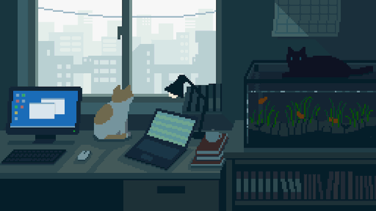

  

<h2 align="center">👩‍💻 About me: </h2>

<h3 align="center">👩‍💻 Mobile Computing Student | Currently Learning Kotlin | Based in Malaysia</h3>

Hello there 👋, I'm Hani Adriana, a Computer Science student at Universiti Malaysia Terengganu (UMT) majoring in mobile computing. I'm still learning, and most of my projects come from university assignments.

So far I've been learning:

<ul>
  <li>📱 Kotlin for native Android development</li>
  <li>🌐 Front-end development and frameworks, through my coursework</li>
  <li>🌦️ Climora, a weather app I made for my front-end subject</li>
  <li>🎮 Godot, which I used to take part in the 5th UMPSA × HUAWEI GameCenter Mobile App Competition 2026</li>
  <li>🌱 I enjoy learning new things and improving step by step</li>
</ul>

<h3 align="left">Languages and Tools:</h3>

         <a href="https://www.mysql.com/" target="_blank" rel="noreferrer">   </a>  

